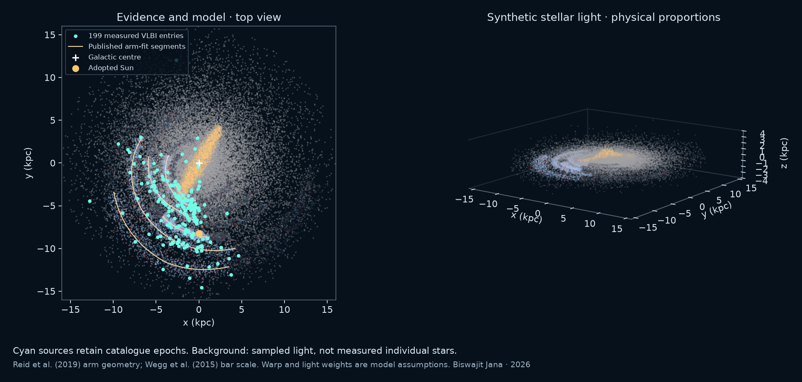

## 16. Building a Galaxy from evidence, and separating gas from stars

The current 3D Galaxy replaces the photograph-derived particle layer and filled outer shell with a reproducible **synthetic stellar-light model**. It is constrained by selected published geometry, not a new fit to the entire Milky Way. There is no external photograph of our Galaxy from this viewpoint.

*Static model-input plot, not a screenshot of the browser renderer. The measured catalogue samples only part of the Galaxy.*

**Measured layer.** The frozen [Reid et al. (2019) VLBI catalogue](https://cdsarc.cds.unistra.fr/viz-bin/cat/J/ApJ/885/131) supplies 199 parallax entries, with 198 distinct rounded Galactic names. Two entries share G123.06−06.30 and have different aliases and measurements; both are retained. These are high-mass star-forming regions, not a representative census of ordinary stars. Nominal distance is $d=1/\varpi$ kpc for parallax in mas. The transformation uses the ICRS–Galactic rotation and this project's Sun position $(0,-8.2,0.020)$ kpc. The raw catalogue, references, importer and SHA-256 checksum are included. Positions retain their catalogue epochs; they are **not propagated to 2026**.

The 168 entries with parallax signal-to-noise at least 5 can show endpoints $1/(\varpi+\sigma_\varpi)$ and $1/(\varpi-\sigma_\varpi)$. These are transformed measurement-error endpoints, not Bayesian distance intervals. No selection-function or covariance correction is made. This overlay and the published arm segments disappear during future playback rather than masquerading as future observations.

**Modelled structure.** Six kinked logarithmic arm segments use Table 2 of [Reid et al.](https://arxiv.org/abs/1910.03357):

$$
\ln(R/R_k)=-(\beta-\beta_k)\tan\psi,\qquad
(x,y)=(-R\sin\beta,-R\cos\beta).
$$

The gold fit overlay stops at the published azimuth intervals. The fainter stellar-light continuation extends those fits by 65° at either end (15° for the Local arm): that extension is an illustration, not an observed or uniquely determined arm map. The bar adopts 30° orientation and 5 kpc half-length, consistent with [Wegg, Gerhard & Portail (2015)](https://arxiv.org/abs/1504.01401), without refitting their data.

The 190,000 points sample **light, not individual measured stars**. Sampling weights are 56% smooth disk, 22% bar and 22% arm component before radius/height rejection. The disk has an adopted 2.6 kpc radial scale and 0.3/0.9 kpc vertical scales; arm colours, clumping, extensions, relative weights, flaring, dust dimming and luminosities are display assumptions. They do not measure stellar density, drive the gravitational potential or predict star formation. The separate environment panel retains its explicitly assumed density model. The kinematic warp uses the existing sourced 700 pc scale at 14 kpc; it is not a fit to the [2025 corrugation](https://doi.org/10.1051/0004-6361/202451668). Default vertical scale is 1×; **Show warped disk** selects labelled 5× and a suitable camera.

### A real, limited hydrodynamics experiment

**Gas hydrodynamics lab** solves the two-dimensional, isothermal Euler equations in a prescribed potential. The 3D surface height represents gas surface density, not the vertical shape of a three-dimensional gas disk:

$$
\partial_t\Sigma+\nabla\cdot(\Sigma\mathbf u)=0,
\qquad
\partial_t(\Sigma\mathbf u)+\nabla\cdot(\Sigma\mathbf u\otimes\mathbf u+c_s^2\Sigma\mathbf I)=-\Sigma\nabla\Phi.
$$

$$
\Phi=\tfrac12 v_c^2\ln[(R^2+r_c^2)/r_c^2]
+\epsilon v_c^2 b^2\frac{(x^2-y^2)\cos2\alpha+2xy\sin2\alpha}{(R^2+b^2)^2}.
$$

Here $r_c=1$ kpc, $b=5$ kpc, $v_c=233$ km/s, $c_s=10$ km/s, $\epsilon=0.1$, and $\alpha=-\Omega_b t$ with $\Omega_b=40$ km/s/kpc. The bar and initial gas rotate in the same clockwise direction in the displayed coordinates. The initial surface density is proportional to $\exp(-R/4\,{\rm kpc})$, with circular speed including its radial pressure gradient in the axisymmetric potential. The bar perturbation is present from the start; the initial state is not an equilibrium with the bar.

Implementation: 64×64 cells over 32×32 kpc, first-order finite-volume Rusanov flux, gravity kicks bracketing the flux update, Courant factor 0.3, and zero-gradient open boundaries. The boundary flux is included in the mass budget. Density is never silently clipped. The independent gas clock runs to 100 Myr; **Export gas grid** supplies positions, density and velocities. **Top view** and **3D density view** change the camera only.

The isothermal closure exchanges heat implicitly and does not evolve an energy equation; compare the [standard hydrodynamics equations documented for Athena](https://princetonuniversity.github.io/Athena-Cversion/AthenaEqns.html). This project uses its own much simpler implementation, not Athena. It omits magnetic fields, self-gravity, cooling physics, feedback, star formation and an observational gas fit. It is numerically diffusive and is **not a validated hydrodynamic reconstruction of the Milky Way**. The stellar orbits, Solar System and heliosphere are not driven by this gas experiment. A credible heliosphere flow calculation would additionally require magnetohydrodynamics and interstellar-plasma boundary data.

Tests preserve uniform gas exactly, conserve periodic mass, account for open-boundary mass flux, compare acceleration with the potential gradient, and recover a small-amplitude travelling acoustic wave with decreasing error on grid refinement. These verify limited numerical behaviour, not astrophysical realism. Stars and planets continue to use gravitational trajectories; fluid equations are not used to produce attractive but unphysical corkscrews.

## 17. What changes after 100, 1,000 and 10,000 years?

<!--FUTURE_RESULTS-->

The Solar path column assumes constant tangential speed 233 km/s on a locally circular Galactic path. Over 10,000 years it covers about 7.77 light-years and 0.01665° around the centre: still the local Galactic neighbourhood, not a journey into a different spiral arm. The gas clock and the 250 Myr context view answer different questions.

Sightline angles come from the **relative** three-dimensional motion of the same 1,387 selected Gaia DR3 sources, propagated from their catalogue epochs to 2026 and then to the comparison year:

$$
\mathbf q_i(t)=\mathbf q_i(t_0)+\mathbf v_{i,\mathrm{rel}}(t-t_0),\qquad
\Delta\theta_i=\operatorname{atan2}(|\mathbf q_i(t_0)\times\mathbf q_i(t)|,\mathbf q_i(t_0)\cdot\mathbf q_i(t)).
$$

This is a **nominal screening calculation**, not a certified 10,000-year ephemeris. Constant velocity omits Galactic differential acceleration, binary dynamics and observer orbital parallax. Uncertainties are not newly propagated for the 1,000- and 10,000-year rows; the earlier century experiment separately provides formal astrometric uncertainty. Gaia quality cuts, available radial velocities and the fixed sample introduce selection effects. Sources not in this sample are not counted as future entrants.

Changing sightlines can open **or close** a transit window. But the isotropic planet population in this direct-imaging calculation marginalises over orbital orientation: its score changes through distance, brightness and angular-separation thresholds, not through the plotted sky angle itself. Identifying new transits requires orbital planes and their uncertainties for individual systems. [Kaltenegger & Faherty (2021)](https://doi.org/10.1038/s41586-021-03596-y) already demonstrated time-dependent membership of Earth's transit zone. This project does not claim that changing viewpoints are an undiscovered idea.

Closer systems can make imaging and spectroscopy easier; they can also have less favourable orbital phase or obscuring dust. **Nothing in these calculations establishes life, a new habitable planet or a future discovery count.** A useful next experiment would rank individual targets at fixed exposure time and instrument performance, propagate binary and astrometric uncertainties, and test whether any gains survive. A second observer needs a feasible spacecraft trajectory: a released probe retains its initial velocity and does not remain at a fixed Galactic location.

### How to inspect the new layers

1. Open **Milky Way → Inspect the measured evidence**. Cyan points are catalogue entries, cyan segments show the selected distance-error endpoints, and gold curves show published arm segments. Rotate/zoom to inspect them.
2. Select **3D stellar reconstruction** to restore synthetic light; use **Show warped disk** for the bend and compare labelled 1×/5× vertical scales. Turn off **Keep bend in view** before choosing your own camera.
3. Open **Gas hydrodynamics lab**, play its independent clock, compare top and density views, and export the cell values. Density-height is a graph, not a warped Galactic surface.
4. In the report's **100 / 1,000 / 10,000 year comparison**, select an interval. Read distance and sightline changes separately from the conditional accessibility score. The Solar System century clock is deliberately not extended beyond its ephemeris domain.
