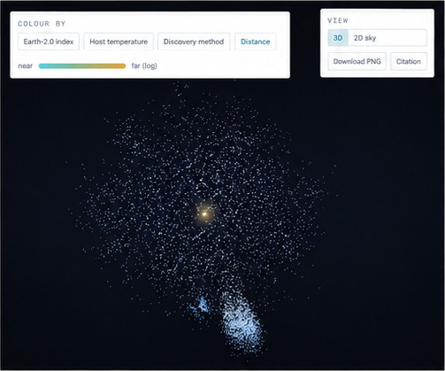

## Solar motion, the heliosphere and the whole-system field

The **heliosphere** is the solar-wind plasma and magnetic environment surrounding the planets. It is distinct from a gravitational sphere of influence and from Earth's magnetosphere. Solar wind and magnetic turbulence modulate Galactic cosmic rays; the amount depends on particle energy, species and solar conditions. High-energy particles still enter, and the Sun itself produces energetic particles. There is no universal shielding percentage in this simulation.

NASA describes competing global-shape models rather than an established rigid spherical boundary. Voyager 1 crossed the heliopause near 122 AU in 2012 and Voyager 2 near 119 AU in 2018, at different directions and times. These two samples do not determine the entire surface. [NASA: heliosphere shape](https://www.nasa.gov/solar-system/uncovering-our-solar-systems-shape/), [Voyager observations and cosmic-ray modulation review](https://doi.org/10.1007/s11214-022-00912-4).

### What the envelope actually calculates

**Sun & all planets → Show the heliosphere** fits a Sun-centred 120 AU spherical reference surface around the system. The dashed 90 AU termination shock is another adopted scale, not a fit to either Voyager crossing. Solar-wind dots move radially at an assumed constant 400 km/s and stop at that shock. Dots recycled at the inner boundary are tracers, not a particle-density model. Beyond the shock, the wind slows and the simple radial model no longer applies. The sphere follows the Sun as a reference geometry; it does not simulate the flow response to a changing interstellar medium.

$$
r(t)=r_0+u_{\rm sw}t,\qquad u_{\rm sw}=400\ {\rm km\,s^{-1}}=84.38\ {\rm AU\,yr^{-1}}.
$$

At that assumed speed the kinematic travel time to 1 AU is **4.33 days**, to 30 AU **129.9 days**, and to 90 AU **389.6 days**. These are constant-speed estimates, not measured parcel arrival times. The reference heliopause radius is four times Neptune's approximately 30 AU orbit. Magnetic-field geometry, shocks, charge exchange, radiation doses and cosmic-ray transport are **not solved**. The demonstration does not insert a fictional protective force into planetary dynamics. NASA's [solar-wind explanation](https://science.nasa.gov/sun/what-is-the-solar-wind/) and [IMAP mission](https://science.nasa.gov/mission/imap/) provide the observational context.

### Forward travel and readable trajectories

The physical trajectory in the adopted local Galactic coordinates is the barycentric Solar-System trajectory plus common Galactic translation. The translating display frame subtracts a velocity, not a distance scale:

$$
\mathbf x'_i(t)=\mathbf R_{\rm SSB}(t)+\mathbf r_{i,\rm SSB}(t)-f\mathbf V_0t,\qquad f\in\{0,0.98\}.
$$

For 233 km/s and $f=0.98$, the residual forward speed is **4.66 km/s**, approximately **0.983 AU/year**. All simultaneous relative positions are unchanged: $\mathbf x'_i-\mathbf x'_j=\mathbf r_i-\mathbf r_j$. Thus winding paths become legible without stretching orbits. Earth & Sun uses this 98% frame for its forward-path option; Sun & all planets also offers the full Galactic frame. The camera stays fixed at its entry epoch unless **Follow Sun with camera** is enabled. Reset camera re-centres it. Over long playback objects can naturally leave a fixed camera's field of view.

The gold Solar trail includes mass-weighted planetary reflex motion in Sun & all planets. Earth & Sun uses the smooth Solar reference trajectory. Planetary trails are limited to two revolutions by default to reduce overplotting; uncheck that option for the selected full history. This truncates displayed history, never orbital coordinates. The Moon uses an illustrative circular orbit; select its close-up to resolve it. Body sizes are enlarged outside that close-up and the Solar-wobble view.

### Entire Solar System in Space & Time

The default view contains the Sun, eight planets and an illustrative Moon at their three-dimensional barycentric positions, rotated into ecliptic axes. Its years clock advances all bodies. Selecting an individual body switches to the separate one-day clock. The optional potential sheet is an analogy with arbitrary depth; bodies remain at their physical positions and do not sink into that sheet.

At the displayed test point, fixed at $(0,0,1)$ AU in barycentric ecliptic coordinates, all ten masses contribute:

$$
\Phi(\mathbf x,t)=-\sum_i\frac{GM_i}{|\mathbf x-\mathbf r_i(t)|},\qquad
\mathbf a(\mathbf x,t)=-\sum_i GM_i\frac{\mathbf x-\mathbf r_i(t)}{|\mathbf x-\mathbf r_i(t)|^3}.
$$

$$
\frac{d\tau}{dt}\simeq1+\frac{\Phi}{c^2}-\frac{v^2}{2c^2},\qquad
\Delta_{\rm lag}\simeq-\frac{\Phi}{c^2}\times86400\times10^6\ \mathrm{\mu s/day}\quad(v=0).
$$

The readout is the instantaneous weak-field rate of a clock held at that coordinate point, relative to the isolated-system asymptotic coordinate clock. It is not a clock attached to Earth or a free-falling spacecraft. For comparison, an isolated Sun at 1 AU contributes approximately **0.00593 m/s²** and **853 microseconds/day** of gravitational lag. The full readout varies with the actual summed field; no arbitrary diagram depth enters it. The Galactic external potential and time-coordinate scale conventions of precision ephemerides are omitted. Single-body experiments retain their isolated Schwarzschild formulas, and the separate coupled **1PN lab** provides a higher-order dynamical comparison. This is not a numerical solution of the full Einstein equations.

### Finding Earth 2.0: related work and dated plots

[Finding Earth 2.0 observatory](https://biswajit1999.github.io/finding-earth-2/) · [source and methods](https://github.com/Biswajit1999/finding-earth-2) · [author perspective](https://biswajit1999.github.io/finding-earth-2/perspective/).

*Historical screenshot reproduced from the original discussion note. It is a catalogue view, not a predicted future sky; its precise catalogue version and image-generation provenance are not independently established here.*

*Saved analysis dated 28 August 2026. The related project's summary contains 6,354 confirmed planets and 4,764 host systems, plus five Solar-System controls. This plot uses 5,767 planets with temperature and incident-flux data, including 1,659 with radius below two Earth radii. The Earth-2.0 index is a similarity/evidence score, not a probability of life. Habitable-zone placement does not demonstrate surface habitability. Figure provenance and hashes are saved in `output/figures/provenance.json`. This dataset and the Moving Observer's 1,387-source injection experiment are different samples.*
