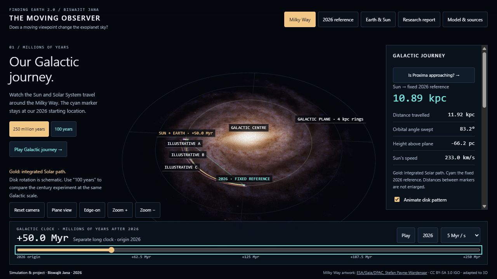

# The Moving Observer

### Does a moving viewpoint change the exoplanet sky?

**By Biswajit Jana · Finding Earth 2.0**  
Version 6.0 · Community discussion project · 24 October 2026

The Sun moves through the Milky Way, and so do the stars around it. Could their changing relative positions bring different planetary systems within reach of observation—or change which planets transit from our viewpoint?

This project connects a 3D Milky Way demonstration with a reproducible Gaia DR3 experiment: 1,387 selected nearby sources, correlated astrometric uncertainties, and a paired comparison of century-scale motion versus instrument thresholds. It includes a fixed-reference experiment, Proxima case study, and a paper-style report with equations and tutorials.

**[Open the simulation](https://biswajit1999.github.io/moving-observer/)** · **[Read the report](https://biswajit1999.github.io/moving-observer/Report.html)** · **[Discuss or correct the work](https://github.com/Biswajit1999/moving-observer/issues/new/choose)**

> **Status:** an educational model and working discussion report, not a peer-reviewed discovery, spacecraft proposal, or reliable 250-million-year forecast for named stars. The principle that stellar motion changes transit viewing opportunities already has published precedent, cited explicitly in the report.



The image above is a version 5 preview, not a screenshot of the updated report.

## New in version 6

- A frozen ESA Gaia DR3 snapshot, exact query, provenance, full five-parameter covariance and measured radial velocities. Missing RVs are excluded, never set to zero.
- A 2026–2126 four-scenario experiment: present/future geometry crossed with baseline/improved instrument thresholds. A fixed hypothetical Earth-radius, 1 AU population isolates geometry. Outputs are single-visit accessibility scores, not discovered planets.
- Formal astrometric uncertainty intervals, source-level CSV export and a threshold sensitivity control. At the default settings, motion changes the summed score by +0.00911; improved thresholds add +73.09093. The motion effect changes sign at 70 mas IWA. These are model-dependent screening results.
- A sourced-scale, precessing outer-disk warp illustration; a separate gravity-integrated Solar-height plot; and true-proportion winding paths for the four inner planets.
- A justified, two-column desktop paper layout, responsive single-column reading, printable equations, and the experiment tutorial.
- A corrected interpolation cadence and nine new validation groups.

**Research question:** Which individual targets retain a useful motion-induced gain after realistic observing budgets, binary dynamics and planetary populations are included? The current contribution is an inspectable comparison and source ranking. Novelty is not established; see [literature search](LITERATURE_SEARCH.md).

## What the project answers

- **Do stars move with us?** They share some Galactic rotation but have different velocities and orbits. Relative motion controls changing sightlines; the Sun's travelled distance alone does not.
- **Is Proxima getting closer?** Yes, currently. The documented linear calculation gives about 4.24 light-years at 2026 and a minimum near 3.10 light-years about 26,700 years later. It uses historical published inputs without binary dynamics or propagated uncertainties.
- **Can a different viewpoint help?** It can alter angular separation, brightness and transit alignment. Detection also depends on the planetary system and instrument. Getting closer does not establish habitability.
- **What happens over 250 Myr?** The demonstration integrates the Sun and three synthetic targets independently. These are explicitly invented examples, not real stars or forecasts of future discoveries.

The research question is: **for which real systems and observing methods does relative stellar motion produce a meaningful, measurable change in detection opportunity?**

## Explore the website

| View | What it shows | Scope |
|---|---|---|
| Milky Way | Sun, fixed 2026 reference, integrated paths and three moving targets | 0–250 Myr; illustrative Galactic potential |
| 2026 reference | Earth/Sun drift from the initial Earth location | 2026–2126; AU distances |
| Earth & Sun | Inclined inner orbits; optional three-year winding spatial track | JPL approximation; same century clock |
| Research report | Full equations, evidence, assumptions and questions | Embedded reading view, printable and offline |
| Proxima lab | Approach, minimum and recession; distance/flux/angle readouts and CSV | −50 kyr to +100 kyr; constant relative velocity |
| Transit control | Entry/exit from a circular orbit's transit band | Invented Earth–Sun analogue, not Proxima b |

Click **Research report** in the main navigation, or **Is Proxima approaching?** in the Galactic sidebar. This full reading view is separate from the shorter **Model & sources** notes. The report includes a [step-by-step tutorial](https://biswajit1999.github.io/moving-observer/Report.html#report-section-12) for every view, both clocks and the exports. Use **Print / save PDF** for a printable copy. Standalone [Report.html](Report.html) includes the same interactive case study.

The Galactic and century clocks are saved separately. Switching scenes pauses playback. Drag to orbit, scroll to zoom, or use **Plane view** and **Edge-on**. In **Earth & Sun**, select **Show 3-year path through Galaxy** for the winding spatial trajectory at true AU proportions. Body markers are enlarged.

## Run offline

Download [Moving_Observer_2026.html](https://github.com/Biswajit1999/moving-observer/raw/refs/heads/main/Moving_Observer_2026.html) and open it in a modern WebGL-enabled browser. The single file includes the simulation, report, equations, images and Proxima lab. No online libraries or assets are required during use. External source/GitHub links need internet access. `index.html` and `Galactic_Journey.html` are identical build aliases.

## Reproduce

Requires **Node.js 22.12 or newer**; CI uses Node 24.

```sh
git clone https://github.com/Biswajit1999/moving-observer.git
cd moving-observer
npm ci
npm run research
npm run build
npm test
```

Optionally run `python -m http.server 8788` and open `http://localhost:8788/`.

The source uses plain JavaScript, Three.js and CommonJS numerical modules. esbuild bundles the application. Markdown-it and KaTeX run at build time; equations become native MathML for offline reading.

The research calculation is in `research.cjs`, its frozen inputs and formal uncertainties are described in [data provenance](data/GAIA_PROVENANCE.md), and results are in [JSON](data/research-results.json) and [CSV](data/research-targets.csv). Run `python fetch-gaia.py` only for an intentional data refresh. Ordinary builds and tests use local inputs.

The Gaia sample is incomplete and quality-selected; it is not a census of nearby planetary systems. The threshold proxy has no exposure-time budget, scheduler or occurrence model. It cannot predict the number of new planets discovered by 2126. The warp is a kinematic display, not an evolving gravitational potential. Do not use the 250 Myr illustration to propagate named nearby systems.

## Scientific model

For observer and target star:

$$
\mathbf R=\mathbf r_\star-\mathbf r_{\rm obs},\qquad
\mathbf V=\mathbf v_\star-\mathbf v_{\rm obs},\qquad
\dot d=\frac{\mathbf R\cdot\mathbf V}{|\mathbf R|}.
$$

The model distinguishes **distance travelled**, **displacement from a fixed reference**, and **distance to a moving target**. A common velocity added to observer and target cancels from their relative motion.

The Galactic potential combines a Miyamoto–Nagai disk, Plummer bulge and logarithmic halo, normalized to 233 km/s circular speed at 8.2 kpc. The Sun starts 20 pc above the plane with 7 km/s upward velocity. Synthetic target states are supplied explicitly. This is not a Gaia fit. The display adds soft luminous particles, illustrative disk thickness, bulge, warp and simplified edge-on dust attenuation to the credited reconstruction. These visual parameters are not fitted 3D observations. Optional rigid disk-pattern rotation is schematic; artwork points are not independently measured/integrated stars.

The Proxima calculation uses Kervella, Thévenin & Lovis (2017), Table 2, with 1991.25 astrometry propagated to 2026. Constant relative velocity omits its bound orbit around Alpha Centauri AB. Displayed precision supports reproducibility, not confidence in a future encounter prediction. See [REPORT.md](REPORT.md) for the equations and limitations.

The cyan fixed reference is a coordinate thought experiment. A passive probe retains velocity and accelerates under gravity. Holding a coordinate fixed would require velocity cancellation and force compensation; no mission feasibility is claimed.

## Validation and data

`npm test` runs **41 check groups**: seven century checks, eight underlying-potential checks, four independent audit groups, six long-clock checks seven stellar-motion checks and nine new research checks. These include archived JPL Horizons comparisons for four planets at six epochs, independent scalar closest-approach geometry, radial/transverse decomposition, common-velocity cancellation, transit boundaries and convergence tests. They assess implementation consistency and selected comparisons—not observational validation of the entire model.

| File | Purpose |
|---|---|
| [REPORT.md](REPORT.md) + [RESEARCH_EXPERIMENT.md](RESEARCH_EXPERIMENT.md) / [Report.html](Report.html) | Paper sources and rendered report |
| [data/research-results.json](data/research-results.json) | Paired experiment and uncertainty outputs |
| [data/astropy-comparison.json](data/astropy-comparison.json) | Independent coordinate/unit benchmark |
| [data/proxima-input.json](data/proxima-input.json) | Measurements, units, epoch, source and recorded errors |
| [data/synthetic-tracers.json](data/synthetic-tracers.json) | Exact assumed states for the example targets |
| [stellar-results.json](stellar-results.json) | Derived results used in the report |
| [Proxima_relative_motion.csv](Proxima_relative_motion.csv) | 1,501 samples from −50 kyr to +100 kyr |
| [Moving_Observer_Galactic_250Myr.csv](Moving_Observer_Galactic_250Myr.csv) | 501 Galactic samples |
| [Moving_Observer_2026_2126.csv](Moving_Observer_2026_2126.csv) | 101 century samples |
| [AUDIT.md](AUDIT.md) | Verification evidence and limits |
| [MODEL_NOTES.md](MODEL_NOTES.md) | Detailed underlying v4 model and frames |
| [discussion-note.pdf](discussion-note.pdf) | Original two-page note supplied by Biswajit Jana |

## Questions for the community

1. Which studies already answer this question? What references or counterarguments are missing?
2. Which real target and method make the strongest first test, holding instrument capabilities fixed?
3. How should catalogue selection handle binaries, missing radial velocities, covariance and selection effects?
4. Which observable and uncertainty treatment would make the Proxima example scientifically useful?
5. What would falsify or substantially limit the proposed observing advantage?

Use the [scientific feedback template](https://github.com/Biswajit1999/moving-observer/issues/new/choose) for corrections and suggestions. Reproducible counterexamples are welcome. See [CONTRIBUTING.md](CONTRIBUTING.md) and the [discussion brief](COMMUNITY_DISCUSSION.md). Citing a scientist does not imply their endorsement.

## Selected prior work

- Kervella, Thévenin & Lovis (2017), *Proxima's orbit around α Centauri*, A&A 598 L7. [Paper](https://arxiv.org/abs/1611.03495).
- Kaltenegger & Faherty (2021), *Past, present and future stars that can see Earth as a transiting exoplanet*, Nature 594, 505–507. [Paper](https://arxiv.org/abs/2107.07936). Directly relevant changing transit-viewpoint geometry.
- Bailer-Jones et al. (2018), *New stellar encounters discovered in the second Gaia data release*, A&A 616 A37. [Paper](https://arxiv.org/abs/1805.07581). Galactic integration with measurement-uncertainty propagation.

The report contains full references and a dated NASA Exoplanet Archive count. The code predicts neither discovery counts nor habitability.

## Authorship and rights

**Biswajit Jana** is the project originator and credited author. Independent scientific review is welcome. Published measurements and research are credited to their authors. No institutional affiliation or peer-reviewed status is claimed.

Milky Way artwork: **ESA/Gaia/DPAC, Stefan Payne-Wardenaar**, **CC BY-SA 3.0 IGO**; its display adaptation retains that licence. Dependencies retain upstream licences. See [THIRD_PARTY_NOTICES.txt](THIRD_PARTY_NOTICES.txt). Original code and text remain copyright Biswajit Jana, with no blanket open-source licence granted; see [RIGHTS.md](RIGHTS.md).
