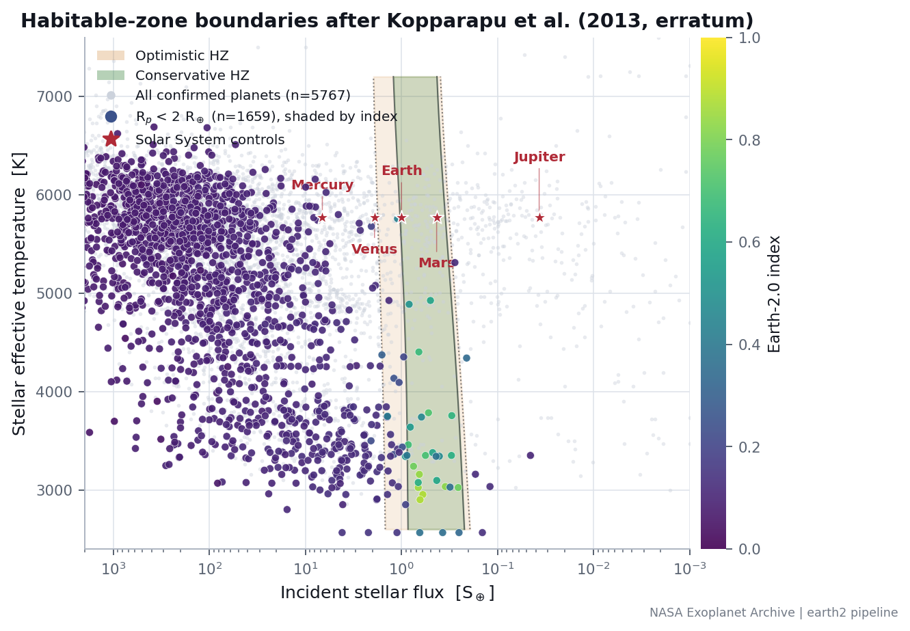

<div align="center">

# The Moving Observer
### Does a moving viewpoint change the exoplanet sky?

**Biswajit Jana · Finding Earth 2.0 · 2026**<br>
Independent research, reproducible calculations and an interactive 3D simulation

[**Explore the simulation**](https://biswajit1999.github.io/moving-observer/) · [**Read the full report**](https://biswajit1999.github.io/moving-observer/Report.html) · [**Six-page illustrated report**](output/pdf/Moving_Observer_Illustrated_Report.pdf) · [**Ask or critique**](https://github.com/Biswajit1999/moving-observer/issues/new/choose)


*The original question, illustrated. A/B/C and the stellar arrows are schematic, not predicted future observations. Reproduced from the supplied discussion note; underlying artwork provenance is not independently established.*

</div>

## The question

The Sun travels around the Milky Way while Earth orbits the Sun. Other stars also move. Could the resulting **relative motion** bring planetary systems closer, change which planets transit, or improve direct imaging? Would an independently moving probe provide a useful extra viewpoint?

This project makes the question testable through explicit reference frames, a fixed-reference experiment, a Proxima case study, Galactic density scenarios and a frozen Gaia DR3 calculation. It also shows where those models stop answering the question.

> **Current result:** in the selected 1,387-source experiment, 100 years of motion changes the baseline accessibility sum by **+0.00911 (+0.03075%)**. The chosen instrument-improvement scenario adds **+73.09093**. These are conditional accessibility scores, **not numbers of planets discovered**. A different angular threshold reverses the motion effect. No novelty, habitability discovery or institutional endorsement is claimed.

## A quantitative answer in one paragraph

At an adopted Galactic tangential speed of **233 km/s**, the Sun travels approximately **4,915 AU (0.0777 light-years) in 100 years**; the integrated model including vertical motion gives **4,917.34 AU**. Travelling 100 light-years takes about **128,608 model years**, during which targets also move. The historical Proxima inputs imply present approach at **22.19 km/s** along the line of sight; a constant-velocity extrapolation reaches about **3.10 light-years after 26,700 years**, with important binary and acceleration omissions. A density scenario normalized to **373 stars within 10 pc** varies from about **292 to 397 stars** in an instantaneous 10 pc sphere over 250 Myr. That is neither a count of new arrivals nor a forecast of discoveries. Instrument capability, target selection, planet populations and observing time are still required to predict detections.

## Explore the physics in 3D

| View | Try this | What is calculated |
|---|---|---|
| **Milky Way** | Show warped disk; compare 1× and 5× vertical display | A 250 Myr Solar orbit in a smooth static potential; a separate kinematic warp |
| **2026 reference** | Compare the fixed marker and passive probe | AU separations; the passive probe inherits its release velocity |
| **Earth & Sun** | Play the forward-path view; reset camera when needed | A three-year path in a frame translating at 98% of Solar velocity, with true orbital distances |
| **Sun & all planets** | Compare full Galactic and 98% frames; toggle Follow Sun | Eight planetary orbits, illustrative Moon, mass-weighted Solar reflex and a prominent gold Solar trail |
| **Heliosphere** | Show the heliosphere in Sun & all planets | A labelled 120 AU reference envelope, 90 AU shock scale and radial 400 km/s wind tracers |
| **Space & Time** | Play the entire Solar System, then select Earth | All-body positions on a years clock; summed weak field at a fixed test point; separate isolated-body clock experiments |
| **Coupled 1PN lab** | Integrate, then play all planets | Sun, eight planets and Moon with Newtonian/first-post-Newtonian comparison |
| **Research report** | Open Proxima and catalogue experiments | Equations, uncertainty propagation, sensitivity controls, tutorial and CSV exports |

The scene occupies the space between the controls rather than rendering behind them. Labels have collision avoidance and leader lines; a permanent body-colour key remains available. Planet histories are capped at two revolutions by default to reduce clutter; the cap changes drawing history, not physics. The Sun keeps the selected full trail. The Moon requires a close-up to resolve at its physical orbital scale.

**Camera and scale:** the forward-path camera is fixed at the epoch at which the view is entered. The Sun visibly advances; **Follow Sun** keeps it centred instead. Reset camera re-centres a scene that has moved outside the field of view. Body markers are enlarged, except where explicitly stated. A 5× Galactic vertical display changes appearance only. The default Space & Time overview uses years; single-body clocks use seconds.

## Equations behind the model

### Relative motion controls the sky

$$
\mathbf r_{\mathrm{obs}}(t)=\mathbf R_{\mathrm{SSB}}(t)+\mathbf r_{\mathrm{Earth,SSB}}(t),\qquad
\hat{\mathbf n}_i(t)=\frac{\mathbf r_i(t)-\mathbf r_{\mathrm{obs}}(t)}{\lVert\mathbf r_i(t)-\mathbf r_{\mathrm{obs}}(t)\rVert}.
$$

$$
\Delta\theta\simeq\frac{v_{\mathrm{rel},\perp}\Delta t}{D},\qquad
L=v_\odot\Delta t,\qquad
T_{\mathrm{Gal}}\simeq\frac{2\pi R_0}{v_\odot}.
$$

For $R_0=8.2$ kpc and $v_\odot=233$ km/s, the nominal circular period is **216.2 Myr**. A transverse relative speed of 30 km/s at 100 ly gives about **20.6 arcseconds per century**. These equations distinguish path length from observer–target separation. Long extrapolations require dynamics rather than constant velocities.

### Winding paths are frame dependent

$$
\mathbf x'_i(t)=\mathbf R_{\mathrm{SSB}}(t)+\mathbf r_{i,\mathrm{SSB}}(t)-f\mathbf V_0t,
\qquad f=0\ \mathrm{or}\ 0.98.
$$

Subtracting the same translation from every body preserves all instantaneous relative distances. At $f=0.98$, 233 km/s leaves a residual **4.66 km/s**, or **0.983 AU/year**. This reveals winding planetary tracks without stretching the orbits. The Sun's barycentric reflex, its Galactic vertical oscillation and the outer-disk warp are different phenomena; none implies a universal corkscrew path through spacetime.

### Gravity and clocks

$$
\Phi(\mathbf x,t)=-\sum_i\frac{GM_i}{|\mathbf x-\mathbf r_i(t)|},\qquad
\mathbf a(\mathbf x,t)=-\sum_i GM_i\frac{\mathbf x-\mathbf r_i(t)}{|\mathbf x-\mathbf r_i(t)|^3}.
$$

$$
\frac{d\tau}{dt}\simeq1+\frac{\Phi}{c^2}-\frac{v^2}{2c^2}.
$$

The whole-system readout evaluates the ten-body field at **(0, 0, 1) AU in barycentric ecliptic axes**, with a clock held stationary there ($v=0$). Its instantaneous lag is referenced to the isolated-system asymptotic coordinate clock; it is not an Earth-surface clock. An isolated Sun at 1 AU gives about **0.00593 m/s²** and **853 µs/day** gravitational lag. The potential sheet's arbitrary visual depth never enters the calculation.

For the separate isolated, nonrotating spherical-body experiments:

$$
\left(\frac{d\tau}{dt}\right)_{\mathrm{held}}=\sqrt{1-\frac{2GM}{rc^2}},\qquad
\left(\frac{d\tau}{dt}\right)_{\mathrm{circular}}=\sqrt{1-\frac{3GM}{rc^2}}.
$$

| Test | Result | Reference / limitation |
|---|---:|---|
| Earth, circular orbit at 400 km | **92.414 min** period; **−24.743 µs/day** | Relative to stationary spherical-Earth surface clock |
| Earth, circular orbit at 20,200 km | **+38.514 µs/day** | Same ideal surface reference; not a complete GPS correction |
| Mercury two-body 1PN benchmark | **42.9798 arcsec/century** | Analytic comparison: 42.9807 |
| Coupled Moon, ten-year comparison | **Up to 215 km position discrepancy** | Against saved JPL data; not navigation accuracy |
| Solar reflex, 1,001 century samples | **93,704–1,273,966 km** from barycentre | Mixed approximate-inner/Horizons-outer reconstruction |

The 1PN lab integrates the Einstein–Infeld–Hoffmann approximation with a fixed RK4 step from saved JPL initial states. It is **not full numerical relativity**. See [relativity methods and validation](RELATIVITY_REPORT.md).

## Does waiting improve detection?

The frozen experiment injects one hypothetical Earth-radius, 1 AU, albedo-0.3 planet per selected Gaia source and averages over isotropic orientation/phase. The baseline scenario uses **60 mas**, **10⁻¹⁰ contrast** and **G = 30**; the improved scenario uses **40 mas**, **5 × 10⁻¹¹** and **G = 31**. These are chosen thresholds, not specifications of an approved telescope.

| Geometry | Baseline thresholds | Improved thresholds |
|---|---:|---:|
| 2026 | 29.63207064 | 102.72300368 |
| 2126 | 29.64118177 | 102.72476157 |

$$
\Delta_{\mathrm{motion}}=S_{10}-S_{00},\quad
\Delta_{\mathrm{instrument}}=S_{01}-S_{00},\quad
I=S_{11}-S_{10}-S_{01}+S_{00}.
$$

Here the first index selects present/future geometry; the second selects baseline/improved thresholds. All four scores use the same source population.

- Motion contribution: **+0.00911112**, with a formal 95% astrometric interval of **+0.00868 to +0.01152**, using **1,024 correlated draws per source**.
- Instrument contribution at the initial epoch: **+73.09093304**.
- **42 sources gain and 45 lose** accessibility; those are score changes, not discovered planets.
- Changing the baseline inner working angle to **70 mas** reverses the net motion contribution to approximately **−0.00145**.

The formal interval excludes uncertainties in planet populations, instruments, binary orbits and cross-source systematics. The sample is not a complete 20 pc census. Isotropic phase averaging removes absolute viewing-direction sensitivity, so this experiment does **not** test future transit entry for known orbital planes. See [full experiment](RESEARCH_EXPERIMENT.md), [frozen results](data/research-results.json) and [literature search](LITERATURE_SEARCH.md).

## Stellar density and speed: what can we infer?

The smooth thin/thick-disk scenario is normalized to a historical **373-star census inside 10 pc**, giving $n_0=373/(4\pi10^3/3)=0.0890\ \mathrm{pc^{-3}}$. Over the model's 250 Myr orbit it spans **0.784–1.063** times its starting density, equivalent to **292–397** stars in an instantaneous 10 pc sphere. It excludes arm enhancements, clusters and migration. Neither the textured galaxy nor the heliosphere determines this density.

For a homogeneous population with an illustrative relative speed of 30 km/s, the incoming rate through a sphere of radius 10 pc is $n\pi b^2v$, giving **0.086 inward crossings per century**. This simple flux estimate is not a precise encounter prediction, a count of all sightline changes, or a discovery yield.

| Galactic radius | Circular speed in this model |
|---|---:|
| 5 kpc | 221.8 km/s |
| 8.2 kpc | 233.0 km/s |
| 12 kpc | 244.9 km/s |
| 16 kpc | 255.0 km/s |

These are outputs of the chosen potential, **not a fit to the latest observed rotation curve**. Height above the plane affects population density and kinematics; it does not uniquely specify a star's speed. See [environment methods](ENVIRONMENT_REPORT.md).

## The Sun's envelope

The **heliosphere** is a plasma and magnetic environment, not an impenetrable shell. The visualization uses a **120 AU spherical reference**, an illustrative **90 AU termination shock**, and **400 km/s radial wind** inside the shock. At that assumed speed, 1 AU takes **4.33 days** and 90 AU **389.6 days**. Voyager crossed the heliopause near **122 AU (2012)** and **119 AU (2018)** in different directions; these do not establish a global spherical radius.

Cosmic-ray modulation depends on energy, species and solar conditions. High-energy particles penetrate, and solar activity also creates energetic particles. No magnetic-fluid solution, radiation dose, shielding percentage or planetary force from the envelope is calculated. [NASA heliosphere overview](https://www.nasa.gov/solar-system/uncovering-our-solar-systems-shape/) · [IMAP](https://science.nasa.gov/mission/imap/) · [implementation and equations](HELIOPHYSICS_REPORT.md).

## Connection to Finding Earth 2.0

[**Open the observatory**](https://biswajit1999.github.io/finding-earth-2/) · [**Source and methods**](https://github.com/Biswajit1999/finding-earth-2) · [**Author perspective**](https://biswajit1999.github.io/finding-earth-2/perspective/)



The saved **28 August 2026** analysis contains **6,354 confirmed planets**, **4,764 host systems** and five Solar-System controls. The plot shows the **5,767** planets with temperature and flux data; **1,659** have radii below two Earth radii. A similarity index is not a life probability, and a habitable-zone classification does not establish surface habitability. This is a dated related-project result, not the same sample as the Moving Observer experiment. [Figure provenance](output/figures/provenance.json).

## Reproduce and review

Node.js 22.12 or later:

```sh
npm ci
npm run build
npm test
```

The build embeds scripts, equations and report illustrations in the offline HTML files. Open `Galactic_Journey.html`, or serve the repository with a local static server. The principal entry points are:

| File | Purpose |
|---|---|
| `physics2026.cjs`, `solar-system.cjs`, `ephemeris.cjs` | Local coordinates, orbital reconstruction and saved ephemerides |
| `galactic-clock.cjs`, `warp.cjs`, `environment.cjs` | Separate Galactic dynamics, warp geometry and density scenario |
| `gravity.cjs`, `relativity.cjs` | Weak-field readouts and coupled 1PN dynamics |
| `heliosphere.cjs`, `heliosphere-view.js` | Explicitly schematic envelope and wind scales |
| `research.cjs`, `data/research-results.json` | Frozen catalogue experiment and outputs |
| `illustrated-report.py`, `report-assets.py` | Six-page report and original-figure provenance |

PDF generation uses Python with NumPy, Matplotlib, Pillow, ReportLab and pypdf. Run `node export-illustrated.cjs`, then `python illustrated-report.py`. The committed figure assets suffice to rebuild the PDF. `report-assets.py` optionally re-extracts the original-note figures and copies the related project's plot from a sibling `finding-earth-2` checkout; hashes identify the source version.

Verification covers units, barycentric identities, frame invariance, Galactic integration, astrometric covariance, detection inequalities, clock rates, 1PN benchmarks and scene construction. **Live WebGL rendering was not revalidated in the restricted browser environment**; source-level scene checks cannot establish visual perfection. See [audit](AUDIT.md).

## What remains open

1. Which real planetary systems have orbital planes and relative velocities precise enough to test a future transit-boundary crossing?
2. Do any motion-induced imaging gains survive exposure-time budgets, repeat visits, binaries and instrument noise?
3. Which feasible spacecraft trajectory adds a useful baseline beyond Earth-based astrometry?
4. How should time-dependent Galactic structure and local interstellar conditions be incorporated without extrapolating observations beyond their validity?

The simulation does not determine a future number of habitable planets. I am an independent researcher without a formal supervisor and welcome expert guidance on the assumptions, prior work and most useful next experiment.

**Authorship:** Biswajit Jana, 2026. Numerical work and original project documents are attributed accordingly. Third-party data and artwork retain their source credits; the Milky Way simulation texture is ESA/Gaia/DPAC, Stefan Payne-Wardenaar, CC BY-SA 3.0 IGO. The original discussion-note illustration has separate, unverified underlying image provenance. No NASA, ESA or ESO affiliation or endorsement is implied.
