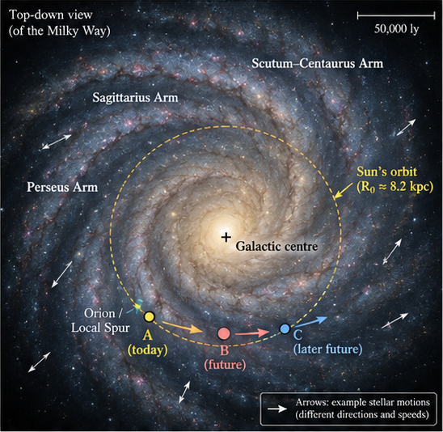

# Does a moving viewpoint change the exoplanet sky?

**A report on relative motion, gravity, and changing opportunities to observe exoplanets**

**Biswajit Jana** 
Finding Earth 2.0 · Independent research and simulation project 
Research and simulation report, version 7.4 · 26 October 2026 · Not peer reviewed

## Report overview

This report investigates a question prompted by curiosity: as the Solar System moves through the Milky Way, could our changing viewpoint help us observe different planetary systems? It describes what the simulation calculates, what the current results mean, and what evidence would be needed for a stronger conclusion. Neighbouring stars move too, so relative motion is central to the question. This project asks how their **relative** motion changes distances, directions and opportunities to observe exoplanets. We distinguish three questions: how far we move from a fixed spatial reference; how far we move relative to a particular star; and whether the resulting geometry improves a specified detection method. These are different calculations. The demonstration combines a 250-million-year illustrative Galactic orbit model, a published-input Proxima Centauri case study, and a simple transit-geometry experiment. It does not forecast a number of newly discovered or habitable planets. A new Gaia DR3 experiment adds 1,387 selected sources, correlated astrometric errors and a four-scenario comparison of century motion and instrument thresholds. It finds a small, threshold-dependent motion contribution in a standardised planet-injection experiment. This is single-visit accessibility, not a mission discovery forecast.

*Original conceptual illustration reproduced from the supplied discussion note. Named arms, arrows and A/B/C epochs explain the question; they are not a measured future map or an external photograph. Its underlying image provenance is not independently established here. Quantitative trajectories use the separately documented model.*

## 1. What can already be answered?

**Are stars moving with us?** Many nearby disk stars share broadly similar Galactic rotation, but not the same three-dimensional velocity. Their relative positions change. A star's own mass does not set its acceleration in the smooth Galactic potential: gravitational and inertial mass cancel in the test-particle equation. Location, velocity, orbit history and the Galaxy's mass distribution matter. Mutual gravity matters for bound systems and close encounters.

**Will 250 million years give us a different sky?** Yes, but not because we travel through stationary stars. Both observer and targets move. With our assumed 8.2 kpc radius and 233 km/s circular speed, one nominal Galactic period is about 216 million years. After roughly one revolution the Sun is again near the starting azimuth; its neighbours need not be the same. A travelled path length alone cannot tell us which target becomes closer.

**Could that help us detect planets?** It can change apparent brightness, angular separation and transit alignment. Whether that helps depends on the instrument, observing schedule and system geometry. We can already point telescopes in different directions without waiting for Galactic travel. NASA's exoplanet archive displayed **6,451 confirmed planets, dated 15 October 2026**, when checked on 24 October 2026. This is a dated catalogue count, not an estimate of all planets that exist. Kepler's concentrated fields and TESS's much broader sky survey also make it incorrect to treat the catalogue as one fully explored patch of space. [1–3]

**Is Proxima approaching?** Yes. In our historical-input calculation it is approaching along the line of sight at about 22.2 km/s, while also moving sideways. Its full relative speed is about 32.5 km/s. It does not share exactly the Sun's velocity. The interactive case below shows the distinction.

**Would getting closer make a planet habitable?** It could improve observations of that planet; it would not by itself establish habitability. A planet's environment depends primarily on its host star, orbit, atmosphere and other physical properties. A habitable-zone classification is not evidence of a habitable surface or life. [4]

<!--LAB-->

## 2. Reference frames and equations

Let the Galaxy-centred coordinates be non-rotating within the adopted Newtonian model. Subscript S denotes the Sun, E the Earth proxy, and j a target star. Bold symbols are vectors.

$$
\mathbf r_{\rm obs}(t)=\mathbf r_{\rm S}(t)+\mathbf r_{{\rm E}/{\rm S}}(t),\qquad
\mathbf R_j(t)=\mathbf r_j(t)-\mathbf r_{\rm obs}(t),\qquad d_j(t)=\lVert\mathbf R_j(t)\rVert .
$$

The main Galactic view cannot resolve Earth's AU-scale orbit inside a kiloparsec-scale scene, so the observer there is the Solar System marker. The close-up uses the Earth–Moon barycentre approximation documented in the model notes.

$$
\mathbf V_j=\dot{\mathbf r}_j-\dot{\mathbf r}_{\rm obs},\qquad
\hat{\mathbf n}_j=\frac{\mathbf R_j}{d_j},\qquad
\dot d_j=\hat{\mathbf n}_j\cdot\mathbf V_j .
$$

Negative radial velocity means decreasing distance; positive means increasing distance. The transverse component changes the direction on the sky:

$$
\mathbf V_{\perp,j}=\mathbf V_j-(\mathbf V_j\cdot\hat{\mathbf n}_j)\hat{\mathbf n}_j,\qquad
\frac{d\hat{\mathbf n}_j}{dt}=\frac{\mathbf V_{\perp,j}}{d_j} .
$$

For a small angular change and nearly constant distance, the scale is:

$$
\Delta\theta\simeq\frac{V_{\perp,j}\,\Delta t}{d_j}.
$$

This expression must use **relative transverse speed**. Substituting the Sun's 233 km/s Galactic speed would wrongly treat the target as stationary. The original discussion note's example, 30 km/s transverse relative speed at 100 light-years over 100 years, gives approximately 20.64 arcseconds.

### Why a common Galactic velocity cancels

If we add the same constant velocity to both target and observer, their relative velocity stays unchanged:

$$
(\mathbf v_j+\mathbf u)-(\mathbf v_{\rm obs}+\mathbf u)=\mathbf v_j-\mathbf v_{\rm obs}.
$$

That is why a large absolute path length need not give a large change in the exoplanet sky. Equal initial velocities at different Galactic positions do not guarantee constant separation forever: their accelerations can differ.

## 3. Proxima: a reproducible first-order calculation

We use the historical astrometry and corrected radial velocity tabulated by Kervella, Thévenin & Lovis (2017), Table 2. This input set is reproducible; it is not presented as the latest astrometric solution. [5]

| Input | Adopted value |
|---|---:|
| Astrometric epoch | 1991.25 |
| ICRS right ascension | 14 h 29 m 47.7474 s |
| ICRS declination | −62° 40′ 52.868″ |
| Parallax | 768.77 ± 0.37 mas |
| Proper motion in RA, including cos(dec) | −3773.8 ± 0.4 mas/year |
| Proper motion in declination | +770.5 ± 2.0 mas/year |
| Corrected radial velocity | −22.204 ± 0.032 km/s |

We construct orthonormal ICRS basis vectors along the line of sight, increasing right ascension and increasing declination. With parallax and proper motions expressed in the same angular units:

$$
d_{\rm pc}=\frac{1000}{\varpi_{\rm mas}},\qquad
\mathbf v=v_r\hat{\mathbf n}+\frac{4.74047046}{\varpi_{\rm mas}}
\left(\mu_{\alpha *}\hat{\mathbf e}_{\alpha}+\mu_\delta\hat{\mathbf e}_\delta\right)\ {\rm km\,s^{-1}}.
$$

The factor 4.74047046 converts one AU per Julian year to km/s. The initial vector is propagated from 1991.25 to the model year 2026, then the interactive calculation holds its relative velocity constant. Time and velocity are converted consistently to years and pc/year:

$$
\mathbf R(t)=\mathbf R_0+\mathbf Vt,\qquad
t_{\rm min}=-\frac{\mathbf R_0\cdot\mathbf V}{\mathbf V\cdot\mathbf V},\qquad
d_{\rm min}=\lVert\mathbf R_0+\mathbf Vt_{\rm min}\rVert.
$$

These closest-approach equations describe an unconstrained straight-line trajectory. A negative minimum time would mean a past encounter; the Proxima result is positive.

| Derived quantity | This model |
|---|---:|
| Separation at 2026 | 4.240 light-years |
| Radial speed at 2026 | −22.189 km/s |
| Transverse speed at 2026 | 23.765 km/s |
| Total relative speed | 32.513 km/s |
| Time until closest approach | approximately 26,681 years |
| Minimum separation | approximately 3.099 light-years |
| Flux ratio at minimum / 2026 | approximately 1.872 |
| Angular-separation scale ratio at minimum / 2026 | approximately 1.368 |

The last two rows hold luminosity and a projected physical separation fixed. They are geometric factors, not a prediction of telescope signal-to-noise or planetary phase. A roughly 1.87-fold flux increase is modest compared with an arbitrary future improvement in instrumentation; this calculation supplies no reason to postpone observations.

**Limits:** Proxima is bound to Alpha Centauri AB. The linear illustration omits that orbital acceleration, Galactic tides and solar/stellar mutual deflection. Its input uncertainties are recorded but not propagated, so the table is not a confidence interval or a precision encounter forecast. We restrict the interactive illustration to −50,000 through +100,000 years, and do not extend it to 250 Myr. The projected plot lies in the plane spanned by the initial relative position and velocity. Adding the Sun's common Galactic translation would move both tracks without changing their separation in this linear approximation.

## 4. What the 250 Myr experiment actually calculates

The Sun and three **synthetic, explicitly illustrative** targets follow the same smooth axisymmetric potential. The targets are not Proxima, named catalogue stars, or confirmed planetary systems. Their initial offsets and velocity assumptions are supplied in `stellar-motion.cjs` and `data/synthetic-tracers.json`.

$$
\ddot{\mathbf r}_i=-\nabla\Phi(\mathbf r_i),\qquad
\Phi=\Phi_{\rm disk}+\Phi_{\rm bulge}+\Phi_{\rm halo}.
$$

The disk is Miyamoto–Nagai, the bulge Plummer, and the halo spherical logarithmic:

$$
\Phi_{\rm disk}=-\frac{GM_d}{\sqrt{R^2+(a+\sqrt{z^2+b^2})^2}},\qquad
\Phi_{\rm bulge}=-\frac{GM_b}{\sqrt{R^2+z^2+c^2}},
$$

$$
\Phi_{\rm halo}=\frac{v_h^2}{2}\ln\left(\frac{R^2+z^2+r_c^2}{r_{\rm ref}^2}\right),\qquad
v_c^2(R)=R\frac{\partial\Phi(R,0)}{\partial R}.
$$

Here the logarithm's reference scale is 1 kpc and only changes the zero of potential. We adopt disk mass 6.8×10¹⁰ solar masses, a=3 kpc, b=0.28 kpc, bulge mass 5×10⁹ solar masses, c=0.5 kpc and halo core radius 12 kpc. The halo amplitude is calibrated to circular speed 233 km/s at 8.2 kpc. The Sun starts at (0, −8.2, +0.020) kpc with velocity (−233, 0, +7) km/s. These are illustrative assumptions, not a Gaia fit. Coordinates and sign conventions are in `MODEL_NOTES.md`.

We integrate with a kick–drift–kick leapfrog at 0.01 Myr steps. The exact initial state is shared with the century model. Gold traces the Sun; coloured labelled markers show separately integrated synthetic targets. The sidebar reports separation and relative speed for the selected example. The star's own mass is absent from this external-potential equation. The Galaxy's distributed gravitational field matters; orbiting the Galactic centre is not the same as orbiting a lone central point mass.

| Target | Initial separation from Sun | Separation at +250 Myr |
|---|---:|---:|
| Illustrative A | 0.129 kpc | 1.684 kpc |
| Illustrative B | 0.238 kpc | 2.417 kpc |
| Illustrative C | 0.366 kpc | 4.131 kpc |

This particular example set separates over the full interval. It is not a representative sample and cannot establish a Galactic encounter rate, a future nearest-neighbour catalogue or a discovery yield. Their motion nevertheless demonstrates why the observer alone is insufficient. The visible Galaxy uses the ESA/Gaia artist’s reconstruction, with illustrative depth and warp; the separate cyan layer contains measured VLBI positions at catalogue epochs. Optional pattern rotation is schematic. The visual reconstruction is not a set of integrated individual stars. See section 16 for data provenance and limits; [6] documents the artwork.

The Sun travels about 59.57 kpc over 250 Myr but ends about 7.70 kpc from the 2026 fixed reference. At the nominal 216.21 Myr circular period it has travelled about 51.52 kpc and is about 0.062 kpc from that reference. Path length, displacement and star–observer distance must remain separate quantities.

## 5. From changing geometry to detectability

### Direct imaging and brightness

For fixed luminosity L and projected planet–star separation a_perp:

$$
F=\frac{L}{4\pi d^2},\qquad
\theta_{\rm sep}\simeq\frac{a_\perp}{d},\qquad
\theta_{\rm sep}[{\rm arcsec}]=\frac{a_\perp[{\rm AU}]}{d[{\rm pc}]}.
$$

A closer star usually gives more photons and a larger angular planetary separation. It does not automatically improve planet/star flux contrast, since the two fluxes share essentially the same observer distance. A practical model needs instrument throughput, inner working angle, contrast performance, backgrounds, stellar variability and planetary phase.

### Transits

Let the planet's orbital angular-momentum unit vector be h and the host-to-observer direction be n. For a circular orbit of radius a, stellar radius R_star and planetary radius R_p:

$$
b=\frac{a\,|\hat{\mathbf h}\cdot\hat{\mathbf n}|}{R_\star},\qquad
\text{transit geometry possible if}\quad b\leq1+\frac{R_p}{R_\star}.
$$

This is a conjunction geometry test, not a transit light curve or a claim that a transit occurs at the slider's exact time. Orbital phase and an observing window are also needed. For eccentric systems the usual conjunction-distance correction depends on eccentricity and argument of periastron. The toy control uses a circular 1 AU orbit, a Sun-sized host and an Earth-sized planet; it is **not a Proxima b orientation model**. Its angular half-width is about 0.269°. A change of sightline can move a system into or out of that band. Getting closer alone does not guarantee a transit, and fractional transit depth remains approximately (R_p/R_star)².

### Radial velocity and other methods

The Keplerian stellar reflex amplitude is:

$$
K=\left(\frac{2\pi G}{P}\right)^{1/3}
\frac{M_p\sin i}{(M_\star+M_p)^{2/3}}\frac{1}{\sqrt{1-e^2}}.
$$

It has no direct observer-distance term. Brightness affects measurement precision, while viewing inclination affects the projected velocity. Astrometric reflex angles scale inversely with distance; microlensing instead requires a suitable changing alignment with a background source. A selection function must be specific to the detection method.

### Habitability is a separate inference

No control here turns a geometrically accessible planet into a demonstrated habitable world. Proxima b already exists as an observationally detected exoplanet; its habitability cannot be established from our changing distance. It has been independently confirmed with ESPRESSO measurements, and atmospheric survival and stellar activity remain relevant scientific questions. [4,7] This project makes no claim that Proxima b has an atmosphere, liquid water or life.

## 6. Prior work and the contribution of this project

The broad idea that stellar motion changes transit viewing opportunities is already established in the literature. Kaltenegger & Faherty (2021) propagated nearby stars through a 10,000-year interval to identify changing opportunities to see **Earth** transit the Sun. That is a reciprocal viewing-geometry study, not a prediction of how many exoplanets our future observers will discover. It is directly relevant precedent. [8]

Bailer-Jones and colleagues (2018) studied stellar encounters with the Sun using six-dimensional Gaia DR2 data, integrating Galactic orbits and propagating correlated measurement uncertainties. That workflow illustrates what a scientifically defensible encounter calculation needs. It is not evidence that our three synthetic targets are actual predicted encounters. [9]

The project began as a **transparent educational implementation and a focused community discussion question**, originating in Biswajit Jana's supplied note. It connects fixed-reference displacement, relative stellar motion and detection geometry in one inspectable demonstration. No priority claim is made for the general physical principle, and the present code has not established a new planet or a new detection opportunity for a particular real planetary orbit.

## 7. From the initial demonstration to a catalogue experiment

1. Select a dated stellar catalogue and documented quality cuts. Obtain positions, parallaxes, proper motions, radial velocities, covariance matrices and binary-system information. Missing radial velocities must not silently become zero.
2. Transform all stars and the Sun into a consistent frame and epoch. Integrate full systems where required, including Proxima–Alpha Centauri binding. Sample uncertainties and alternative Galactic parameters.
3. Model evolving Galactic structure, encounters and stellar evolution when the timescale demands them. A static smooth potential can be numerically accurate while physically inadequate over 250 Myr. Do not infer a universal prediction horizon from a small integration error.
4. Supply planetary orbital orientations, eccentricities and evolution, or an explicitly statistical distribution when those are unmeasured. A sky-direction change alone is insufficient to predict transit entry for an unknown orbital plane.
5. Define actual instruments and observing schedules. Separate pure geometric gains from improvements in technology, survey coverage, extinction, target availability and selection bias.
6. Validate against independent astrometry/orbit software and published encounter cases. Report posterior distributions, sample completeness and sensitivity to model choices, not just a single future animation.

Section 11 now implements a first catalogue experiment: a dated nearby-source selection, full five-parameter covariance plus independent RV errors, century propagation, a specified threshold model and paired instrument comparisons. The requirements above remain relevant to a full mission forecast; binary dynamics, observatory scheduling and realistic planetary demographics are not solved by this first experiment. The 250 Myr scene supplies Galactic context; it is not the appropriate precision forecast for Proxima's next encounter.

## 8. The stationary probe thought experiment

The cyan 2026 marker is a fixed coordinate, initially at the Earth proxy, in the chosen Galactic frame:

$$
\mathbf r_{\rm ref}(t)=\mathbf r_{\rm obs}(0),\qquad
B(t)=\lVert\mathbf r_{\rm obs}(t)-\mathbf r_{\rm ref}\rVert.
$$

A passive spacecraft inherits its release velocity and accelerates under gravity. Holding it at a fixed coordinate would require cancellation of inherited velocity and continued force compensation. The simulation does not demonstrate that such a mission is feasible. There is no universal absolute-rest location. A useful spacecraft need not remain fixed: [New Horizons and Earth measured stellar parallax from separated observing locations](https://arxiv.org/abs/2506.21666). A future probe extension should compare a feasible trajectory and measured baseline against existing astrometry; this project does not supply a propulsion or navigation design.

The reference is a place, not a preserved moment in time. Looking toward it does not show the year 2026 indefinitely. The century view's distance/c readout is an instantaneous geometric light-time scale, not a solution of retarded emission times. Earth plus Solar motion gives a winding spatial path in some frames; it is not a universal helix through spacetime.

## 9. Verification and reproducibility

Run `npm ci`, `npm run build` and `npm test` using Node.js 22.12 or newer. Build output embeds application assets and pre-rendered mathematical markup; no online library is needed to use the downloaded HTML. `data/proxima-input.json` preserves the cited input set. `stellar-motion.cjs` defines its unit conversions, rectilinear propagation, synthetic tracers and transit geometry. `stellar-results.json` and the exported CSV preserve derived values.

The new research tests also check all catalogue covariance decompositions, source identifier integrity, phase-integrated accessibility, paired epoch-zero controls, threshold monotonicity, warp velocities and exact reproduction of the saved experiment. Tests check astrometric basis reconstruction, radial/transverse decomposition, closest-approach stationarity, common-velocity cancellation, transit boundaries, Galactic integration conservation/convergence and data exports. Existing tests also compare approximate planetary states with archived JPL Horizons samples. These checks establish limited implementation consistency; they do not validate omitted physics or the long-term future of named stars. Detailed historical checks and current results are supplied in `AUDIT.md` and the validation JSON files.

## 10. Questions for researchers and interested readers

- Which parts of this question are already answered by existing transit-zone, encounter, astrometric or direct-imaging studies? Which references should be added?
- Which measurable detection opportunity could change appreciably because of relative motion, with today's instrument capabilities held fixed?
- Which selection biases and unresolved binaries most affect the supplied Gaia DR3 sample? Does the source ranking survive a more complete nearby-star catalogue?
- What uncertainty treatment and comparison case would make the Proxima example scientifically useful?
- Over what timespan does a deterministic calculation stop being informative for the chosen observable?
- What findings would show that this proposed observing advantage is negligible?

Please distinguish corrections to the implementation, corrections to the physics, and possible research extensions. Reports of errors and relevant published answers are especially welcome. Feedback can be submitted through the repository's issue templates. This report does not imply endorsement by any scientist or institution.

## Tutorial: using the simulation

### A. Start with the Galactic view

1. Open the website or downloaded `Moving_Observer_2026.html`. The initial scene is **Milky Way**, paused at the 2026 origin. The long clock covers **250 million years**; Myr means one million years.
2. Click **Play Galactic journey** or **Play**. Gold marks the Sun and its elapsed path. The cyan reference stays at its 2026 Galactic coordinate. The timeline slider selects an epoch; **2026** resets the active clock. **Playback speed** changes how many model years pass per real second; it does not change the equations.
3. Compare **Distance travelled** with **Sun → fixed 2026 reference**. The first is accumulated path length; the second is straight-line separation. **Jump to ≈ one Galactic orbit** illustrates why they differ: the Sun can return near its starting location after travelling a long distance.
4. Use **Plane view** for the disk from above, **Edge-on** for thickness, or **Reset camera** for the initial perspective. Drag to rotate and scroll or use **Zoom + / −** to change magnification. **Plane guides** and **Object labels** can be switched off.
5. **Evolving outer-disk warp** controls a sourced-scale kinematic surface. Use **Edge-on** to inspect it; the Solar-height plot separately reveals vertical oscillation. **Animate disk pattern** controls schematic rotation of the illustrated Galaxy. It does not control the integrated Solar orbit. **Enhance arm contrast** changes display brightness and haze; it does not change stellar density or the gravity model.

### B. Compare the Sun with moving stars

1. In the right-hand controls, scroll to **Moving stars**. On a narrow screen first open **Controls**.
2. Keep **Show illustrative stars** enabled. Select **Illustrative A**, **B** or **C** under **Compare with the Sun**. Each coloured marker has an independent integrated orbit.
3. Move the Galactic timeline and read **Star–Sun separation**, **Relative speed** and **Radial speed**. Negative radial speed means approaching; positive means separating. Total relative speed is a magnitude and is never negative.
4. Compare the target separation with the Sun-to-reference readout. A changing distance to a moving star cannot be inferred from the fixed-reference baseline alone. These three examples are invented initial states, not a real-star catalogue or a planet-discovery prediction.

### C. Explore the Proxima question

1. Click **Research report**, then **Proxima lab** in the report contents, or click **Is Proxima approaching?** in the Galactic sidebar. The report is a separate reading view within the website; **Return to simulation** brings you back.
2. In the lab click **2026**. The distance is about 4.240 light-years, radial velocity about −22.19 km/s, and total relative speed about 32.51 km/s. Read **Approaching** alongside the signed radial value.
3. Click **Closest approach**. In this linear approximation the minimum is about 3.099 light-years, roughly 26,700 years after 2026. Radial speed reaches zero at the minimum, while sideways motion and total speed remain nonzero.
4. Click **+100,000 years**. The star is receding. Scrub the slider to compare the encounter-plane diagram with the distance-versus-time curve. The graph removes the Sun's shared Galactic motion; it is not the Milky Way map.
5. Read the flux and angular-separation ratios. They assume constant luminosity and constant projected physical separation. They are not detection probabilities or estimates of habitability.
6. Use **Export Proxima CSV** to download the full −50,000 to +100,000-year calculation at 100-year intervals. The source measurements, epoch conversion and omitted physics are documented in this report and `data/proxima-input.json`.

### D. Test transit alignment

1. In the Proxima lab expand **Test a transit viewing angle**. This control is a separate invented Earth–Sun analogue, not an orbital orientation measurement for Proxima b.
2. Move the angle toward **0°**, meaning the observer lies in the orbit's plane. The control reports that transit geometry is possible.
3. Move beyond about **±0.269°**. The observer leaves this example's transit band. The displayed impact parameter and threshold explain the change.
4. Remember that this is a geometry test. A real observation also needs the correct planetary phase, observing time and sufficient measurement precision.

### E. Inspect the century experiment and Earth's path

1. Select **100 years** in the Galactic view to see how tiny a century's motion is at whole-galaxy scale. Select **2026 reference** to resolve that same baseline in AU.
2. Move the century clock to **2126**. The Earth-to-reference separation is about 4,917 AU in this assumed model. The cyan marker is a hypothetical fixed coordinate, not a passive spacecraft.
3. Select **Compare a passively released probe** to display the separate simplified tracer that inherits Earth's initial motion. It remains near the Solar System rather than staying at the starting coordinate.
4. Select **Earth & Sun** to resolve the inner orbits. Entry selects **0.1 yr / s**. Faster playback can visually undersample planetary orbits.
5. Enable **Show Earth’s path through Galaxy** to see the sum of Earth's orbit and Solar translation. If the clock is earlier than 2029, enabling this control advances it to 2029 so a three-year trail is available. Blue is Earth's spatial path; gold is the Sun's. The distances are not stretched into a decorative helix. Turn the option off to return to the Earth-orbit framing.
6. The century and Galactic clocks retain their own times. Changing views pauses playback. They do not turn a million-year epoch into a planetary ephemeris millions of years beyond its valid range.

### F. Export and request review

- **Export CSV** in the main simulation downloads either 501 Galactic samples or 101 century samples, according to the active clock. This main export describes the observer/reference model; the three synthetic target initial states and endpoint results are in `data/synthetic-tracers.json`. The report lab has its own Proxima CSV export.
- **Save image** downloads the current 3D scene with epoch, units and attribution. Labels and enlarged markers are display annotations.
- **Print / save PDF** in this report opens the browser's print dialogue. Choose its PDF destination if you want a document copy. The interactive controls become a static snapshot at their selected state.
- Use **GitHub & feedback** to inspect source, data and tests, or open a scientific-feedback issue. When requesting review, state which claim or result you mean, its frame, units and epoch, and whether you are asking about geometry, measurement capability or habitability.

<!--EXPERIMENT-->

<!--SPACE_TIME-->

<!--ENVIRONMENT-->

## References

1. **NASA Exoplanet Archive**, homepage count dated 15 October 2026; accessed 24 October 2026. https://exoplanetarchive.ipac.caltech.edu/
2. **NASA, Kepler / K2 mission overview.** https://science.nasa.gov/mission/kepler/
3. **NASA, TESS mission overview.** https://science.nasa.gov/mission/tess/
4. **NASA, The Habitable Zone**, and **An Earth-like Atmosphere May Not Survive Proxima b's Orbit** (2017). https://science.nasa.gov/exoplanets/habitable-zone/ ; https://www.nasa.gov/science-research/heliophysics/an-earth-like-atmosphere-may-not-survive-proxima-bs-orbit/
5. **Kervella, P., Thévenin, F. & Lovis, C. (2017).** Proxima's orbit around α Centauri. *A&A* 598, L7. DOI: 10.1051/0004-6361/201629930. https://arxiv.org/html/1611.03495
6. **ESA/Gaia/DPAC, Stefan Payne-Wardenaar (2025).** The best Milky Way map by Gaia. Artist reconstruction, CC BY-SA 3.0 IGO. https://www.esa.int/ESA_Multimedia/Images/2025/01/The_best_Milky_Way_map_by_Gaia
7. **Suárez Mascareño et al. (2020).** Revisiting Proxima with ESPRESSO. *A&A* 639, A77. https://arxiv.org/abs/2005.12114
8. **Kaltenegger, L. & Faherty, J. K. (2021).** Past, present and future stars that can see Earth as a transiting exoplanet. *Nature* 594, 505–507. DOI: 10.1038/s41586-021-03596-y. https://arxiv.org/abs/2107.07936
9. **Bailer-Jones, C. A. L. et al. (2018).** New stellar encounters discovered in the second Gaia data release. *A&A* 616, A37. DOI: 10.1051/0004-6361/201833456. https://arxiv.org/abs/1805.07581
10. **JPL approximate planetary positions** and **Gaia ICRS/Galactic transformation** (underlying century model). https://ssd.jpl.nasa.gov/planets/approx_pos.html ; https://gea.esac.esa.int/archive/documentation/GDR3/Data_processing/chap_cu3ast/sec_cu3ast_intro/ssec_cu3ast_intro_tansforms.html

The current rendering maps the detailed ESA/Gaia reconstruction onto a bent three-dimensional disk, with illustrative thickness at grazing angles and an independently selectable VLBI layer (section 16). These depth parameters are not a fitted 3D stellar or dust catalogue. Multi-body planet illumination comes from the modeled Sun with dim ambient light; isolated-body experiments use a presentation light. Overview body markers remain enlarged. The new Sun & all planets inspection control follows a selected body at physical radius, using illustrative mapped surfaces; these do not alter the trajectory or field calculations.

## Authorship and attribution

Biswajit Jana originated the project question and supplied the original community discussion note, included unchanged as `discussion-note.pdf`. The project and this working report are attributed to him. Independent scientific review is welcome. Published measurements and prior research belong to their cited authors; the Gaia artwork carries its own attribution and licence. No institutional affiliation, peer review, discovery claim or outside endorsement is asserted.
